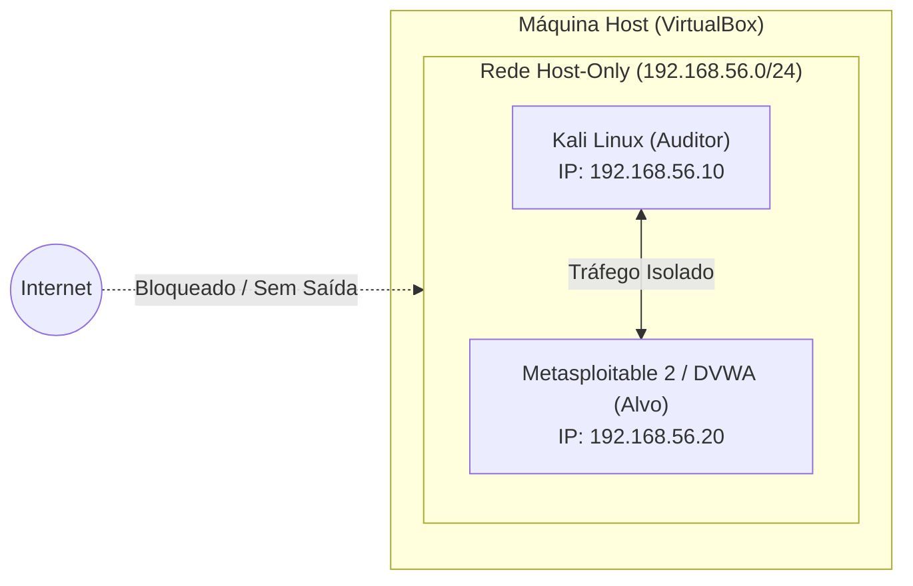

# 🛡️ Laboratório de Auditoria de Autenticação e Prevenção contra Força Bruta

[](https://www.dio.me)
[](#)
[](LICENSE)

Este repositório documenta a implementação de um ambiente controlado de testes de segurança, análise de riscos em serviços de autenticação (FTP, HTTP e SMB) e, principalmente, **estratégias robustas de mitigação, detecção e defesa cibernética**.

Projeto desenvolvido como parte do desafio prático da plataforma **Digital Innovation One (DIO)** focado no estudo de ataques de força bruta, dicionário e password spraying em ambientes de homologação.

---

## 📋 Sumário

- [Visão Geral e Objetivos](#-visão-geral-e-objetivos)
- [Topologia do Laboratório](#-topologia-do-laboratório)
- [Conceitos Teóricos Fundamentais](#-conceitos-teóricos-fundamentais)
  - [Força Bruta vs. Dicionário vs. Password Spraying](#força-bruta-vs-dicionário-vs-password-spraying)
  - [Superfícies de Ataque Analisadas](#superfícies-de-ataque-analisadas)
- [Detecção e Análise de Logs](#-detecção-e-análise-de-logs)
- [Estratégias de Mitigação e Hardening](#-estratégias-de-mitigação-e-hardening)
  - [1. Proteção em FTP (vsftpd)](#1-proteção-em-ftp-vsftpd)
  - [2. Rate Limiting em Aplicações Web](#2-rate-limiting-em-aplicações-web)
  - [3. Políticas de Bloqueio em SMB/Windows](#3-políticas-de-bloqueio-em-smbwindows)
  - [4. Automação Defensiva com Fail2ban](#4-automação-defensiva-com-fail2ban)
- [Estrutura do Repositório](#-estrutura-do-repositório)
- [Boas Práticas e Ética](#-boas-práticas-e-ética)
- [Conclusões](#-conclusões)

---

## 🎯 Visão Geral e Objetivos

O objetivo deste projeto é exercitar a mentalidade de auditoria e segurança defensiva:
1. **Compreender a mecânica** de falhas de autenticação decorrentes de senhas fracas, falta de bloqueio de contas e ausência de limites de requisição (*rate limiting*).
2. **Construir um ambiente isolado (Sandbox)** para reproduzir cenários controlados sem riscos à rede externa ou a terceiros.
3. **Analisar as pegadas (*artifacts/logs*)** deixadas por tentativas massivas de login.
4. **Implementar e documentar contramedidas práticas** (Blue Team) para neutralizar ou mitigar tais vetores de ameaça.

---

## 🌐 Topologia do Laboratório

Para garantir segurança operacional e isolamento rigoroso, todo o ecossistema é hospedado em rede local interna (**Host-Only / Somente Leitora**) no VirtualBox:



- **Máquina de Auditoria**: Kali Linux (contendo utilitários de auditoria de credenciais como Medusa, Nmap, Hydra).
- **Máquina Alvo (Vulnerável)**: Metasploitable 2 / Instância DVWA local.
- **Configuração de Rede**: Interface de rede configurada como *Host-Only Adapter* (ou Rede Interna), desabilitando roteamento para a internet e prevenindo vazamentos de tráfego.

Consulte o [Guia de Configuração do Ambiente](docs/laboratorio-setup.md) para o passo a passo de montagem das VMs.

---

## 🧠 Conceitos Teóricos Fundamentais

### Força Bruta vs. Dicionário vs. Password Spraying

| Modalidade | Características | Indicadores Típicos em Logs |
| :--- | :--- | :--- |
| **Força Bruta Exaustiva** | Testa todas as combinações possíveis de caracteres (ex: `aaaa`, `aaab`, `aaac`). Ineficiente para senhas longas. | Volume massivo de falhas em curtos intervalos para um único usuário. |
| **Ataque de Dicionário** | Utiliza listas pré-computadas de senhas frequentes (ex: `password`, `123456`, `admin`). | Sequência contínua de tentativas de senhas conhecidas em um ou poucos usuários. |
| **Password Spraying** | Testa um número reduzido de senhas comuns (ex: `Empresa@2026`) contra um grande rol de contas de usuários diferentes. | Diversas contas diferentes com poucas tentativas de erro cada, contornando regras simples de *account lockout*. |

### Superfícies de Ataque Analisadas

1. **Protocolo FTP (Porta 21)**:
   - Protocolo legada com tráfego em texto claro.
   - Frequentemente desprovido de mecanismos nativos de limitação de tentativas de login por IP.
2. **Formulários Web (HTTP/HTTPS - Ex: DVWA Login)**:
   - Requisições `POST` processadas por scripts backend (PHP, Node, etc.).
   - Vulnerável quando não há tokens anti-CSRF associados à sessão, CAPTCHAs ou bloqueios progressivos de IP/usuário.
3. **Compartilhamento de Arquivos SMB (Portas 139 / 445)**:
   - Serviço crítico em infraestruturas corporativas (Active Directory / Samba).
   - Suscetível à enumeração de usuários (`RID cycling`, sessões nulas) e *Password Spraying*.

---

## 🔍 Detecção e Análise de Logs

Um dos pilares deste projeto é a observabilidade. Quando um serviço é submetido a testes de autenticação, padrões claros emergem nos logs do sistema:

### 1. Evidências em `/var/log/auth.log` (Linux PAM / SSH / FTP)
```text
Nov  2 21:15:02 target-vm vsftpd: pam_unix(vsftpd:auth): authentication failure; logname= uid=0 euid=0 tty=ftp ruser=admin rhost=192.168.56.10
Nov  2 21:15:03 target-vm vsftpd: pam_unix(vsftpd:auth): check pass; user unknown
Nov  2 21:15:04 target-vm vsftpd: pam_unix(vsftpd:auth): authentication failure; logname= uid=0 euid=0 tty=ftp ruser=root rhost=192.168.56.10
```
> **Alerta do Defensor:** Centenas de requisições por segundo originadas do mesmo endereço IP (`192.168.56.10`) para credenciais genéricas denotam varredura automatizada.

### 2. Evidências em Logs Web (Nginx / Apache `access.log`)
```text
192.168.56.10 - - [02/Nov/2026:21:18:12 -0300] "POST /dvwa/login.php HTTP/1.1" 200 4528 "-" "Medusa/2.2"
192.168.56.10 - - [02/Nov/2026:21:18:12 -0300] "POST /dvwa/login.php HTTP/1.1" 200 4528 "-" "Medusa/2.2"
192.168.56.10 - - [02/Nov/2026:21:18:13 -0300] "POST /dvwa/login.php HTTP/1.1" 200 4528 "-" "Medusa/2.2"
```
> **Alerta do Defensor:** Respostas HTTP 200 repetidas em intervalo de milissegundos sem variação de cabeçalhos e com User-Agents padronizados revelam ferramentas de automação.

Veja mais detalhes e consultas em [Guia de Análise de Logs e Detecção](docs/analise-logs-e-deteccao.md).

---

## 🛡️ Estratégias de Mitigação e Hardening

A parte essencial deste desafio é a resposta defensiva: como garantir que a infraestrutura resista a investidas de força bruta.

### 1. Proteção em FTP (vsftpd)
- **Desabilitar Login Anônimo:**
  ```ini
  anonymous_enable=NO
  ```
- **Limitar Tentativas por Conexão:**
  ```ini
  max_login_fails=3
  delay_failed_login=5
  ```
- **Restringir Escopo:** Fazer chroot dos usuários (`chroot_local_user=YES`) e priorizar SFTP sobre SSH com chaves criptográficas em vez de senhas puras.

### 2. Rate Limiting em Aplicações Web
No Nginx, configura-se limitação de taxa em rotas críticas como `/login`:

```nginx
# Criando zona de memória compartilhada para login (1 requisição por segundo por IP)
limit_req_zone $binary_remote_addr zone=login_limit:10m rate=1r/s;

server {
    location /login {
        limit_req zone=login_limit burst=5 nodelay;
        # ... proxy_pass ou fastcgi_pass
    }
}
```

Além do rate limiting no servidor web:
- **CAPTCHA Adaptativo**: Ativação após 3 erros consecutivos.
- **MFA (Autenticação Multifator)**: Torna credenciais vazadas insuficientes para concessão de acesso.
- **Proteção contra Enumeração de Usuários**: Respostas genéricas como *"Credenciais inválidas"* em vez de *"Usuário inexistente"*.

### 3. Políticas de Bloqueio em SMB/Windows
Para conter *Password Spraying* e força bruta em ambientes Windows ou servidores Samba:
- **Limite de Bloqueio de Conta (Account Lockout Threshold)**: Ex.: Bloquear a conta por 15 minutos após 5 tentativas incorretas.
- **Desabilitar protocolos legados**: Bloquear SMBv1 e exigir assinaturas de pacote (`SMB Signing`) e criptografia de transporte (`SMB Encryption`).
- **Desabilitar Enumeração Anônima**: Bloquear sessões nulas configurando `RestrictAnonymous = 1` no registro ou `restrict anonymous = 2` no `smb.conf`.

### 4. Automação Defensiva com Fail2ban
O `fail2ban` monitora logs de autenticação e insere regras temporárias ou permanentes no firewall (iptables/nftables) ao detectar comportamentos anômalos.

Exemplo de configuração contido neste repositório em [`mitigation/fail2ban-jail.local`](mitigation/fail2ban-jail.local):
```ini
[vsftpd]
enabled  = true
port     = ftp,ftp-data,ftps,ftps-data
filter   = vsftpd
logpath  = /var/log/vsftpd.log
maxretry = 3
findtime = 600
bantime  = 3600
```

---

## 📂 Estrutura do Repositório

```text
dio-lab-medusa-bruteforce/
│
├── README.md                      # Documentação central do projeto
├── LICENSE                        # Licença MIT
│
├── docs/                          # Documentações detalhadas
│   ├── laboratorio-setup.md       # Passo a passo de configuração da rede no VirtualBox
│   └── analise-logs-e-deteccao.md # Análise aprofundada de logs e regras de alerta
│
├── mitigation/                    # Modelos de arquivos defensivos e hardening
│   ├── fail2ban-jail.local        # Configuração comentada de Fail2ban
│   └── nginx-rate-limit.conf      # Exemplo de configuração de rate-limiting para Nginx
│
├── wordlists/                     # Recursos didáticos de teste
│   ├── README.md                  # Explicação sobre geração e boas práticas de wordlists
│   └── exemplo-wordlist.txt       # Wordlist didática com credenciais fracas fictícias
│
└── images/                        # Capturas de tela e evidências do laboratório
    └── .gitkeep                   # Diretório reservado para imagens do autor
```

---

## ⚖️ Boas Práticas e Ética

> **Aviso de Responsabilidade:**  
> Os estudos, metodologias e análises contidos neste repositório têm caráter estritamente educativo e preventivo. Todas as simulações devem ser realizadas exclusivamente em ambientes virtuais isolados e autorizados. O uso de técnicas de auditoria contra sistemas sem permissão formal é ilegal e viola as leis de proteção de dados e crimes cibernéticos (ex.: Lei nº 12.737/2012 e Lei nº 13.709/2018 - LGPD no Brasil).

---

## 🎓 Conclusões

A realização deste laboratório evidencia que:
1. Senhas simples ou previsíveis continuam sendo o elo mais frágil de sistemas expostos.
2. A ausência de limitação de tentativas (*rate limit*) permite que atacantes automatizem milhares de palpites por minuto.
3. Medidas defensivas como **Fail2ban**, **políticas de complexidade**, **bloqueio de contas** e **MFA** são indispensáveis para garantir a resiliência operacional da infraestrutura.

---

*Desenvolvido com foco em Cyber Defense e Aprendizado Contínuo.*
