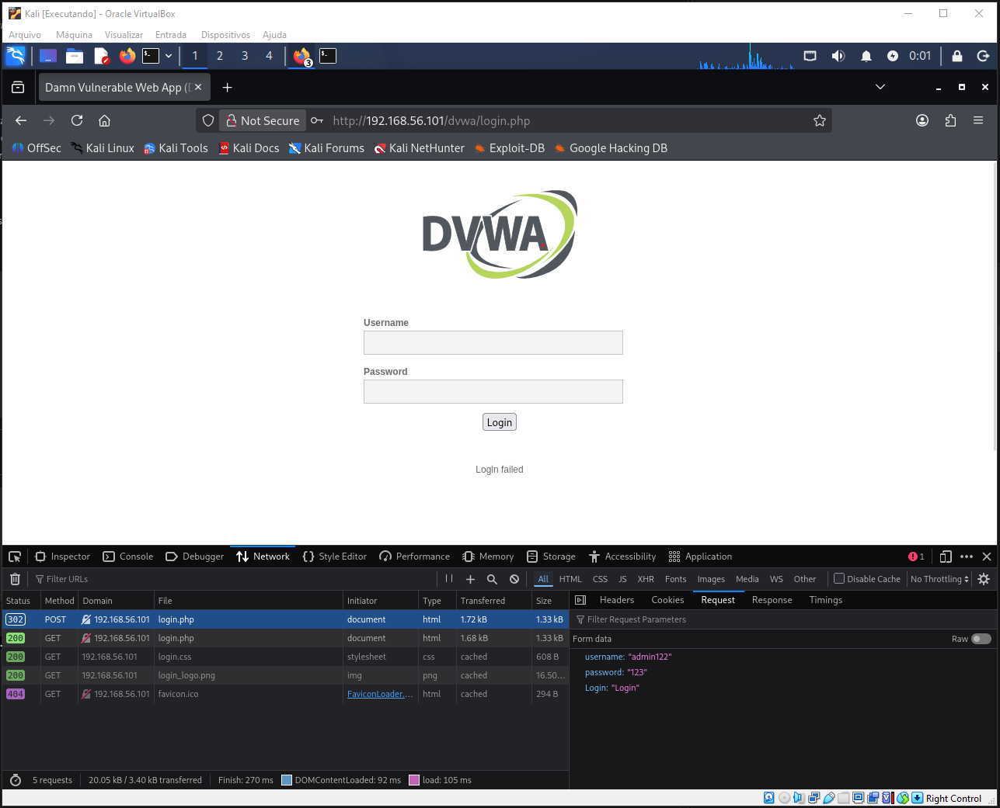
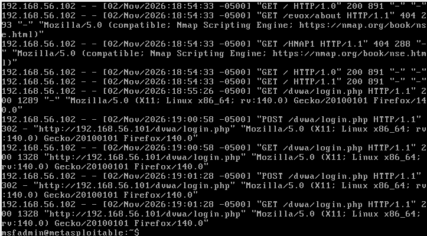

# 🔎 Guia de Análise de Logs e Detecção Forense

Identificar e responder a ataques de força bruta, dicionário e password spraying requer monitoramento contínuo dos logs do sistema operacional e das aplicações.

---

## 1. Onde Localizar os Logs Relevantes

| Serviço | Local Padrão no Linux | Tipo de Evento Registrado |
| :--- | :--- | :--- |
| **Servidor Web (Apache/Nginx)** | `/var/log/apache2/access.log` ou `/var/log/nginx/access.log` | Métodos HTTP, URIs solicitadas, códigos de resposta e User-Agents. |
| **Autenticação Geral (PAM/SSH)** | `/var/log/auth.log` (Debian/Ubuntu) ou `/var/log/secure` (RHEL/CentOS) | Sucessos e falhas de login no sistema operacional. |
| **Servidor FTP (vsftpd)** | `/var/log/vsftpd.log` | Conexões, autenticações e transferências. |
| **Samba / SMB** | `/var/log/samba/log.smbd` | Tentativas de logon de rede e sessões SMB. |

---

## 2. Padrões Típicos Identificados no Laboratório

### Cenário 1: Inspeção de Requisição no Formulário Web (DVWA)
Antes de analisar o log no backend, a inspeção da requisição no cliente (Kali) revelou os parâmetros transmitidos:



- Endpoint: `POST /dvwa/login.php`
- Campos enviados: `username`, `password`, `Login`
- Resposta no insucesso: `302 Found` seguido de `200 OK` com a mensagem `"Login failed"`.

---

### Cenário 2: Análise Forense no Servidor Alvo (`/var/log/apache2/access.log`)
No terminal da Metasploitable (`msfadmin@metasploitable`), a execução do comando `tail -n 20 /var/log/apache2/access.log` revelou o padrão exato da atividade:



Trecho extraído da evidência:
```text
192.168.56.102 - - [02/Nov/2026:18:54:33 -0500] "GET /evox/about HTTP/1.1" 404 293 "-" "Mozilla/5.0 (compatible; Nmap Scripting Engine; https://nmap.org/book/nse.html)"
192.168.56.102 - - [02/Nov/2026:19:00:58 -0500] "POST /dvwa/login.php HTTP/1.1" 302 - "http://192.168.56.101/dvwa/login.php" "Mozilla/5.0 (X11; Linux x86_64; rv:140.0) Gecko/20100101 Firefox/140.0"
192.168.56.102 - - [02/Nov/2026:19:01:28 -0500] "POST /dvwa/login.php HTTP/1.1" 302 - "http://192.168.56.101/dvwa/login.php" "Mozilla/5.0 (X11; Linux x86_64; rv:140.0) Gecko/20100101 Firefox/140.0"
```

#### Indicadores de Comprometimento / Varredura (IoCs):
1. **User-Agent NSE**: Revela de forma explícita o uso do Nmap Scripting Engine para levantamento de vulnerabilidades.
2. **Submissões Sequenciais de Autenticação**: Requisições repetidas de método `POST` direcionadas para o formulário de login a partir do IP único `192.168.56.102`.

---

## 3. Comandos Úteis para Triagem Rápida em Incidentes

```bash
# Contabilizar os IPs com mais requisições no Apache
awk '{print $1}' /var/log/apache2/access.log | sort | uniq -c | sort -nr | head -10

# Filtrar tentativas de login falhas no FTP
grep "FAIL LOGIN" /var/log/vsftpd.log | awk '{print $NF}' | tr -d '"' | sort | uniq -c | sort -nr
```

---

## 4. Regra Conceitual de Detecção (Suricata / Snort)

Para ambientes corporativos com IDS/IPS, assinaturas baseadas em frequência (*thresholding*) alertam sobre tentativas massivas:

```text
alert tcp any any -> any 80 (msg:"POSSÍVEL ATAQUE DE AUTENTICAÇÃO WEB - Múltiplos POSTs no Login"; \
    flow:to_server,established; \
    content:"POST /dvwa/login.php"; http_method; \
    threshold:type both, track by_src, count 5, seconds 10; \
    classtype:web-application-attack; sid:2000001; rev:1;)
```
