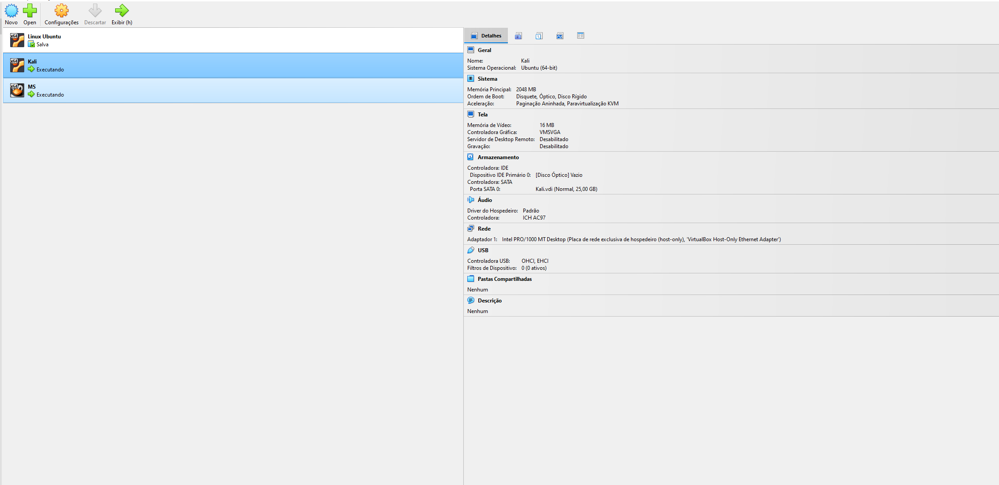
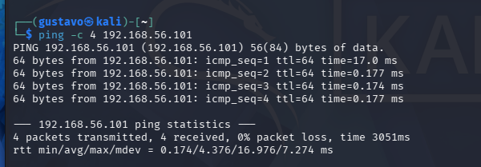

# 🛠️ Guia de Configuração do Laboratório (VirtualBox)

Este documento orienta a criação do ambiente de testes seguro e isolado utilizando o Oracle VM VirtualBox. O isolamento de rede é fundamental para garantir que qualquer teste automatizado permaneça restrito ao laboratório.

---

## 1. Pré-Requisitos

- **Oracle VM VirtualBox** (versão 7.x ou superior).
- **ISO / VM do Kali Linux**: Máquina de auditoria.
- **VM do Metasploitable 2**: Máquina propositalmente vulnerável para homologação de segurança.

---

## 2. Configuração de Rede: Isolamento "Host-Only" (Rede Exclusiva do Hospedeiro)

A rede *Host-Only* cria uma interface virtual privada entre o sistema operacional hospedeiro e as máquinas virtuais, sem permitir que o tráfego saia para a internet física.



### Passo a passo no VirtualBox:

1. No menu principal do VirtualBox, acesse: **Ferramentas (Tools)** > **Rede (Network Manager)**.
2. Crie ou selecione um adaptador exclusivo do hospedeiro (ex.: `VirtualBox Host-Only Ethernet Adapter`).
3. Configure a faixa de endereços IPv4:
   - **Endereço IPv4:** `192.168.56.1`
   - **Máscara de rede:** `255.255.255.0`
4. Habilite o Servidor DHCP ou use os IPs atribuídos automaticamente pelo pool do VirtualBox.

---

## 3. Configuração das Máquinas Virtuais

### A. Máquina de Auditoria (Kali Linux)
1. Nas configurações da VM:
   - **Rede** > **Adaptador 1**:
     - *Conectado a:* **Placa Exclusiva do Hospedeiro (Host-Only)**.
     - *Nome:* Selecionar o adaptador criado no passo anterior.
2. Inicie a VM e verifique a conectividade:
   ```bash
   ip a
   ```
   *No laboratório executado, o IP atribuído ao Kali foi:* `192.168.56.102`.

---

### B. Máquina Alvo (Metasploitable 2)
1. Nas configurações da VM:
   - **Rede** > **Adaptador 1**:
     - *Conectado a:* **Placa Exclusiva do Hospedeiro (Host-Only)**.
     - *Nome:* O mesmo adaptador utilizado no Kali Linux.
2. Inicie a VM (Login padrão: `msfadmin` / `msfadmin`).
3. Verifique o endereço IP:
   ```bash
   ifconfig eth0
   ```
   *No laboratório executado, o IP atribuído à Metasploitable foi:* `192.168.56.101`.

---

## 4. Validação de Conectividade Interna

Do terminal do Kali Linux, foi validada a resposta do alvo exclusivamente na rede interna:

```bash
ping -c 4 192.168.56.101
```



Confirmada a troca de pacotes ICMP com sucesso, comprovando o isolamento e comunicação direta entre as duas instâncias.

> **Regra de Segurança:** Nunca configure a máquina vulnerável com adaptador em modo *Bridge* conectado diretamente à rede corporativa ou residencial com acesso à internet, pois serviços intencionalmente vulneráveis ficariam expostos a varreduras externas.
